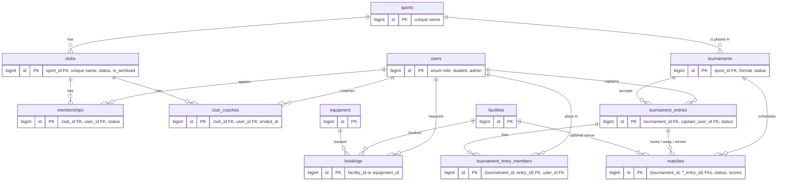

# Database design (ERD)

Owner: Jassim. This is the authoritative schema for SportsHub. Tables are created only by the ordered SQL files in `database/migrations/`. Propose schema changes to Jassim before adding a migration.

## Entity relationships

## Migration order

| File | Owner | Tables |
| --- | --- | --- |
| `001_authentication_users.sql` | Mukilan | `users`, `auth_rate_limits` |
| `002_resources_and_bookings.sql` | Mursid | `facilities`, `equipment`, `bookings` |
| `003_sports_and_clubs.sql` | Jassim (schema), Looga (API) | `sports`, `clubs` |
| `004_memberships_and_coaches.sql` | Jassim | `club_coaches`, `memberships` |
| `005_tournaments.sql` | Jassim | `tournaments`, `tournament_entries`, `tournament_entry_members` |
| `006_matches.sql` | Jassim | `matches` |
| `007` onward | Ask Jassim for the next number | Announcements, training/attendance, notifications, reports |

`php backend/bin/setup.php` applies every `NNN_lowercase_name.sql` file in numeric order. It refuses two files that share a number, so renumber yours if main already has it. Every migration must be re-runnable: use `CREATE TABLE IF NOT EXISTS` and never `DROP` or automatic `ALTER`. Add each new table's key columns to `$expected` in `setup.php`, which verifies existing tables before applying anything.

`php backend/bin/setup.php --seed` also applies `database/seeds/`. `001_sports.sql` adds the reference sports and `002_demo_clubs.sql` adds development clubs that match the frontend preview. Both use `INSERT IGNORE` on unique names, so they are safe to re-run.

## Conventions for new tables

- `BIGINT UNSIGNED AUTO_INCREMENT` primary keys named `id`. Foreign key columns are `<entity>_id` with the same type, and every reference has a `FOREIGN KEY`.
- `DATETIME` in UTC (`Database` sets the session time zone to `+00:00`). `created_at`/`updated_at` use `DEFAULT CURRENT_TIMESTAMP [ON UPDATE CURRENT_TIMESTAMP]`. Use `DATE` for calendar dates.
- `ENUM` for workflow states, with transitions enforced in PHP.
- InnoDB, `utf8mb4`, `utf8mb4_unicode_ci`.
- Rows referenced by history are archived or given a terminal status, never deleted.
- **One live row per pair.** A stored generated `active_flag` column is `1` for live rows and `NULL` otherwise, and is covered by a `UNIQUE` index. Unique indexes ignore `NULL`, so this enforces "one pending/approved membership per club and user" while keeping any number of historical rows. It works on MySQL 8 and MariaDB 10.6+.
- **Same-tournament references.** `tournament_entries` has `UNIQUE (tournament_id, id)`. Members and matches reference `(tournament_id, entry_id)` through composite foreign keys, so the database rejects a match or member that mixes tournaments.
- `CHECK` constraints back up PHP rules that must never be violated. Examples: no self-review, distinct match sides, the winner is one of the two sides, and a completed match has scores.

## Workflow states

| Table | States | Transitions (who) |
| --- | --- | --- |
| `memberships` | `pending`, `approved`, `rejected`, `withdrawn`, `ended` | pending → approved or rejected (Admin, or a coach of the club, never the applicant); pending → withdrawn (applicant); approved → ended (member, coach or Admin). A student may reapply after rejected, withdrawn or ended. |
| `club_coaches` | live while `ended_at` is NULL | An Admin assigns a coach and ends the assignment. |
| `tournaments` | `draft`, `registration_open`, `registration_closed`, `in_progress`, `completed`, `cancelled` | draft → registration_open; registration_open ↔ registration_closed; registration_closed → in_progress (needs ≥ 2 approved entries); in_progress → completed (no scheduled or postponed matches). Any non-final state → cancelled. Admin only. |
| `tournament_entries` | `pending`, `approved`, `rejected`, `withdrawn` | pending → approved or rejected (Admin, or a coach of the sport, never a member of the entry); pending or approved → withdrawn (captain, before fixtures). Changes are only allowed while registration is open or closed. |
| `matches` | `scheduled`, `postponed`, `completed`, `cancelled` | An Admin schedules, postpones or cancels. A result completes the match and can be corrected until the tournament completes. |

## Schema review of other branches (30 Oct)

These need changing before those branches merge:

1. **`feat/shahilan-club-interface`.** Rename `002_announcements.sql` to `007_announcements.sql`, because `002` is taken and setup now refuses duplicates. Remove its stub `CREATE TABLE clubs (id INT ...)`. If the stub ran first, `IF NOT EXISTS` would stop the real `clubs` table from being created. Make `announcements.club_id` `BIGINT UNSIGNED` so its foreign key matches `clubs.id`. Consider `BIGINT` ids and `created_at`/author columns for consistency.
2. **`feat/natheeshan-club-backend`.**
   - Use the `003` schema above: `clubs.status` is `active`/`recruiting`/`full`/`inactive` and `is_archived` is `0`/`1`.
   - Move the routes into the shared `backend/public/index.php` and reuse `SportsHub\Database`, `Session` (auth/CSRF), `Validation` and the `{data, error}` response shape instead of a separate router, `Database` and `{success, message}` format.
   - Training and attendance tables still need a migration (`008`), agreed with Jassim.
3. **`002_resources_and_bookings.sql` (Mursid).** `bookings.requested_by` and `bookings.reviewed_by` have no foreign key to `users`. Add them in a later migration once the team agrees how to alter existing installations safely.
